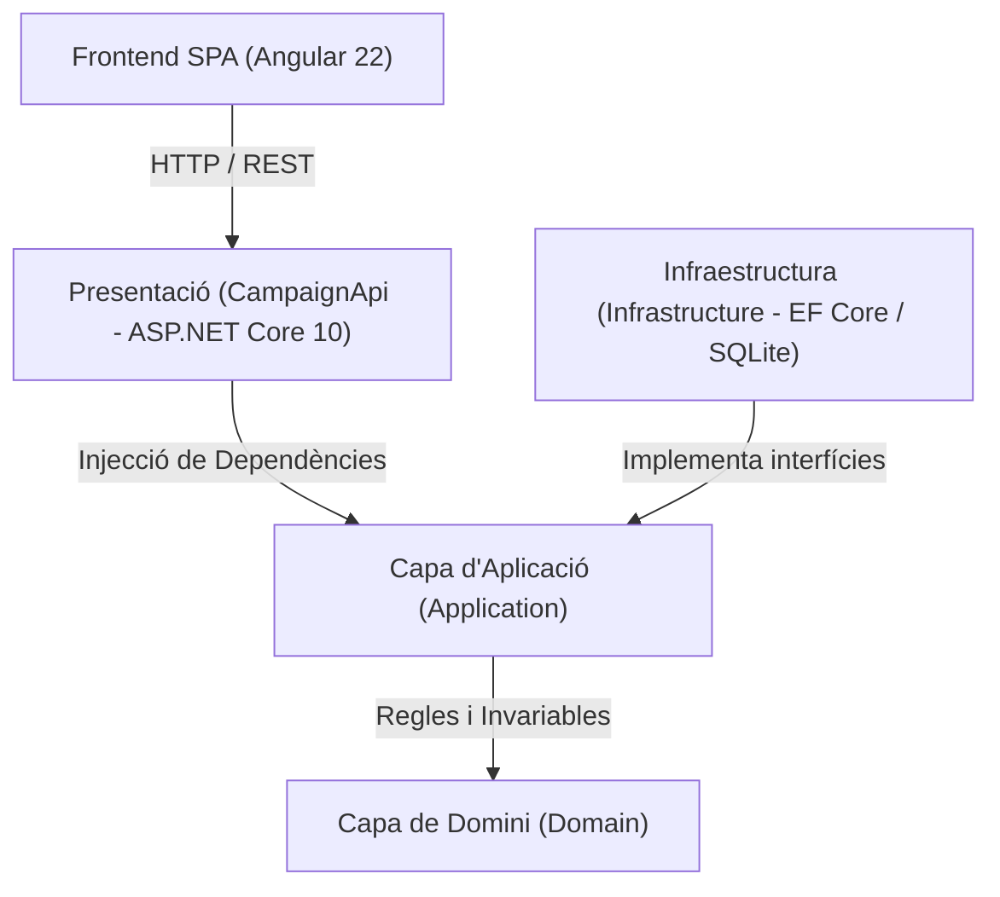

# Arquitectura del Sistema — CampaignManager

Aquest document descriu l'arquitectura global, les decisions de disseny, el flux de dades i els patrons aplicats al projecte **CampaignManager**.

---

## 1. Visió general

El sistema ha estat dissenyat seguint els principis d'**Arquitectura Neta (Clean Architecture / Onion Architecture)** i **Disseny Orientat al Domini (DDD)**. Aquest enfocament desacobla totalment la lògica de negoci de les tecnologies d'infraestructura, de la base de dades i dels frameworks de presentació.

---

## 2. Capes del Backend (.NET 10)

### 2.1. Capa de Domini (`Domain`)
És el nucli del sistema i **no té cap dependència externa** (ni d'altres projectes ni de paquets NuGet).

- **`Campanya` (Entitat d'arrel d'agregat / Entity)**:
  - Encapsula l'estat i protegeix les invariants de negoci en tot moment.
  - El constructor garanteix que no pugui existir cap campanya en estat inconsistent (nom de mínim 3 caràcters, pressupost superior a zero, data de fi posterior a la d'inici, estat inicial `ESBORRANY` i consum inicial `0`).
  - Mètodes de comportament rics:
    - `Activar(DateTimeOffset ara)`: Valida que la campanya no estigui caducada, que no estigui finalitzada i que disposi de saldo.
    - `Pausar()`: Valida que només es pugui pausar si està `ACTIVA`.
    - `Consumir(decimal import, DateTimeOffset ara)`: Valida la vigència temporal, que l'estat sigui actiu, que no superi el límit disponible i commuta automàticament a `FINALITZADA` si s'esgota el pressupost total.
- **`EstatCampanya` (Enum)**:
  - Defineix els estats possibles: `ESBORRANY`, `ACTIVA`, `PAUSADA`, `FINALITZADA`.

### 2.2. Capa d'Aplicació (`Application`)
Coordina els casos d'ús i actua com a pont entre el domini i l'exterior. Depèn únicament de `Domain`.

- **Interfícies d'abstracció**:
  - `ICampanyaService`: Contracte de les operacions d'alt nivell (Crear, ObtenirPerId, Llistar, CanviarEstat, Consumir).
  - `IGenericRepository<TEntity>`: Contracte per desacoblar l'accés a dades.
  - `IUnitOfWork`: Contracte per gestionar la transacció i persistència atòmica de canvis.
- **DTOs (Data Transfer Objects)**:
  - `CrearCampanyaDTO`, `CampanyaDTO`, `CanviarEstatCampanyaDTO`, `ConsumirPressupostDto`.
  - Immunables (`record`) i independents de les entitats internes de persistència.
- **`CampanyaService`**:
  - Implementa la lògica d'orquestració.
  - Utilitza l'abstracció nativa `TimeProvider` de .NET per obtenir la data/hora actual, permetent una testabilitat determinista sense dependre del rellotge de la màquina host.

### 2.3. Capa d'Infraestructura (`Infrastructure`)
Implementa les interfícies definides a la capa d'aplicació. Depèn d'`Application` i `Domain`.

- **`AppDbContext`**:
  - Context d'Entity Framework Core 10 configurat per a **SQLite**.
  - Configuració fluent de la taula `Campanyes` (`Nom` amb límit de 100 caràcters, camps obligatoris, clau primària `Guid`).
  - Implementa `IUnitOfWork` gestionant el cicle de vida de la transacció (`SaveChangesAsync`).
- **`GenericRepository<TEntity>`**:
  - Implementa les operacions CRUD genèriques (`GetByIdAsync`, `GetAllAsync`, `AddAsync`, `Update`, `Remove`).
  - `GetAllAsync` empra `.AsNoTracking()` per optimitzar lectures en consultes de llistat.
- **Migracions**:
  - Esquema versionat amb migrations d'EF Core (`InitialCreate`).

### 2.4. Capa de Presentació / API (`CampaignApi`)
Punt d'entrada HTTP construït amb **ASP.NET Core 10 Web API**.

- **`CampaignsController`**:
  - Exposa els 5 endpoints REST seguint convenis semàntics de codis HTTP:
    - `POST /campaigns` -> `201 Created` / `400 BadRequest`
    - `GET /campaigns` -> `200 OK` / `400 BadRequest` (amb filtre `?estat=...`)
    - `GET /campaigns/{id}` -> `200 OK` / `404 NotFound`
    - `PATCH /campaigns/{id}/status` -> `204 NoContent` / `400 BadRequest` / `404 NotFound` / `409 Conflict`
    - `POST /campaigns/{id}/consume` -> `204 NoContent` / `400 BadRequest` / `404 NotFound` / `409 Conflict`
- **Configuració global (`Program.cs`)**:
  - Serialització d'enums amb `JsonStringEnumConverter()`.
  - Política CORS permesa per al port d'Angular (`http://localhost:4200`).
  - Migració automàtica de la base de dades a l'arrencada (`db.Database.Migrate()`).
  - Documentació OpenAPI integrada.

---

## 3. Arquitectura del Frontend (Angular 22)

L'aplicació d'usuari està estructurada com una Single Page Application (SPA) amb components Standalone:

- **Estructura reactiva i lleugera**:
  - Ús de components Standalone (`imports: [DecimalPipe, FormsModule]`).
  - Servei centralitzat `CampanyesService` fent ús de `HttpClient` i observables `rxjs`.
- **Interfície completa en una única vista operativa**:
  - **Barra lateral** d'espai de treball i navegació.
  - **Capçalera** amb accions ràpides i formulari desplegable per a la creació.
  - **KPIs i estadístiques** en temps real (total de campanyes, actives, pressupost total assignat, consum global i percentatge).
  - **Píndoles de filtratge** per estat (`Totes`, `Actives`, `Esborranys`, `Pausades`, `Finalitzades`).
  - **Taula de gestió** amb visualització de períodes, pressupost total, **pressupost restant calculat**, barra de progrés de consum i accions dinàmiques segons l'estat.
  - **Formulari contextual de consum**: permet introduir l'import directament a la fila de la campanya activa seleccionada, validant en client i sotmetent a l'API amb bloqueig de dobles enviaments (`operacionsEnCurs`).

---

## 4. Estratègia de Testabilitat

L'arquitectura permet un desacoblament absolut que facilita el testing a múltiples nivells:

1. **Tests Unitaris de Domini (`CampanyaTests`)**:
   - Verifiquen directament l'entitat `Campanya` i les seves invariants sense instanciar bases de dades ni mocks complexos.
2. **Tests de Serveis d'Aplicació (`CampanyaServiceTests`)**:
   - Utilitzen fakes lleugers en memòria (`FakeGenericRepository`, `FakeUnitOfWork`, `TestTimeProvider`).
   - Execució ultra-ràpida (menys de 60 ms per a 56 tests).
3. **Tests de Controladors (`CampaignsControllerTests`)**:
   - Verifiquen els codis de retorn HTTP i les respostes JSON per a cada cas límit.
4. **Tests de Frontend (`Angular-UI`)**:
   - `HttpTestingController` per simular i verificar les peticions HTTP de `CampanyesService`.
   - Tests de component aïllats amb providers simulats.
